# Penny

A money manager for Indian users, with Penny, a coin who reacts to how your month is going. An Android app built with Flutter.

<p align="center">
  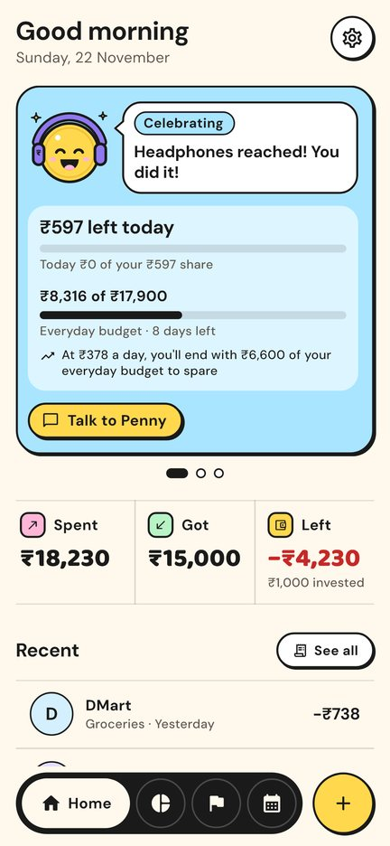
  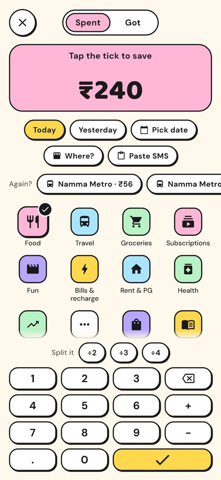
  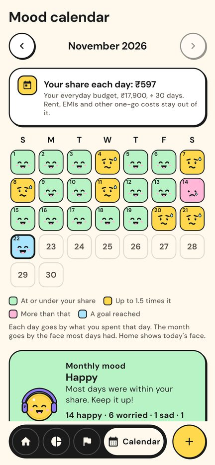
  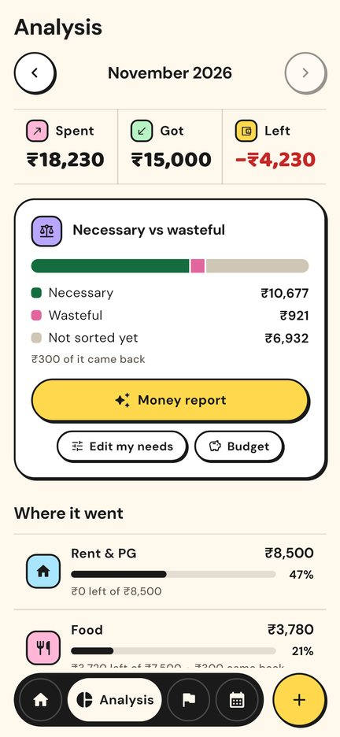
</p>

**Status: eight milestones done, then a round of fixes and a new look from real use.**
- **Logging and capture:** manual entry with bill splitting, usual entries and typing it in one go, bank SMS import, payments read from notifications, paybacks and investing, your own money moving between wallet and bank, combining entries.
- **Understanding and planning:** the Analysis tab, Penny's wasteful-spending report, My needs, the chat with Penny, the budget with Penny's moods and a forecast, the mood calendar, goals with Penny's plans, autopays with reminders, fixed bills each month, search, CSV export, the Money report, payments coming up.
- **Around it:** Penny's animations and notifications, the welcome, Google sign-in with backup and sync, reading older bank SMS and the app lock.

Receipt photos come later. All money in the screenshots is made-up demo data.

## The idea

Most people in India now pay by UPI: dozens of small payments a week, each with a bank SMS. Money rarely goes in one big purchase. It goes ₹120 at a time, without anyone noticing, and the month ends with less left than expected and no clear idea why.

Expense apps don't fix this, for four reasons:
- **Typing every payment is a chore**, so people stop after a week.
- **A list of numbers doesn't say** whether the month is going well.
- **Generic advice** ("spend less on food") doesn't know your month or what matters to you.
- **Many apps upload** every SMS, account number and contact.

Penny tries the opposite:
- **Capture without typing.** Penny reads payments from your bank SMS and payment-app notifications (GPay, PhonePe, Paytm and others) on the phone, with rules first and AI only for what the rules can't read. Typing one by hand still takes seconds.
- **Feel the month, not just count it.** Your budget becomes a fair share for each day. Penny, a cartoon coin, is happy when a day stays within its share, worried a little over it, and sad well over it. The mood calendar shows the whole month at a glance.
- **Advice that knows you.** Her AI sorts spending into necessary and wasteful by *your* needs, explains each wasteful item, finds habits worth cutting, plans savings goals, and answers questions in English, Hindi or Hinglish.
- **Numbers you can trust.** Every rupee figure is worked out on the phone from your entries. The AI only judges and explains, so it can't get a total wrong.
- **Private by design.** Everything lives on the phone. The AI sees month totals per shop, with people only as "Person 1, 2", never SMS text, account numbers or names. Backup is optional.

## Screens

| | | |
|:---:|:---:|:---:|
| <br>**Home**: Penny's mood, what's left today, the month | 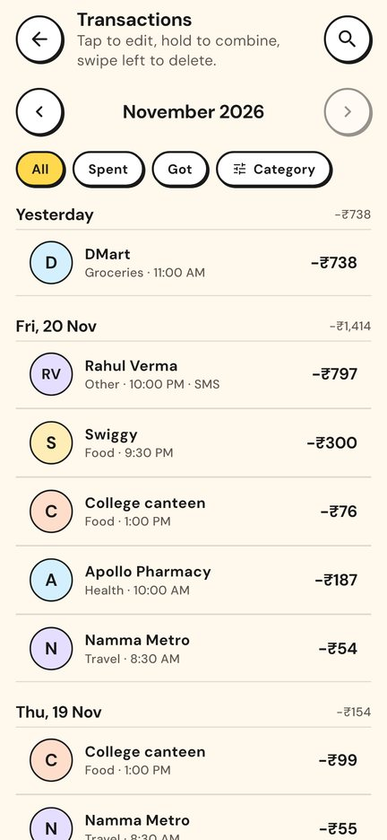<br>**See all**: every entry, with search and filters | 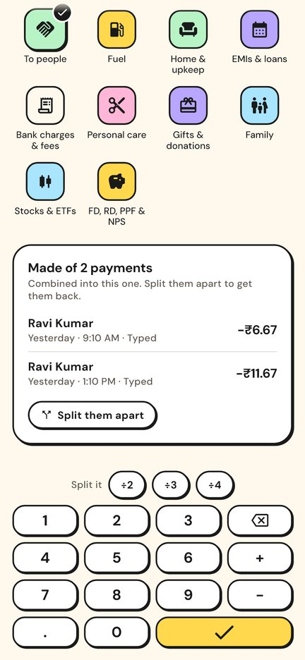<br>**A combined entry** and what it's made of |
| 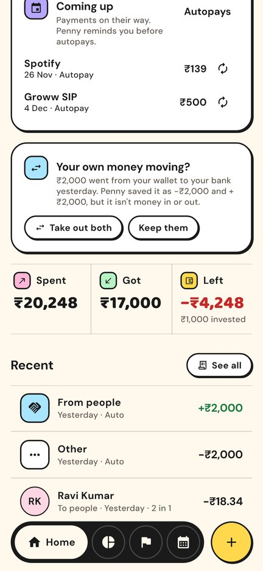<br>**Your own money moving**: wallet to bank isn't spending | 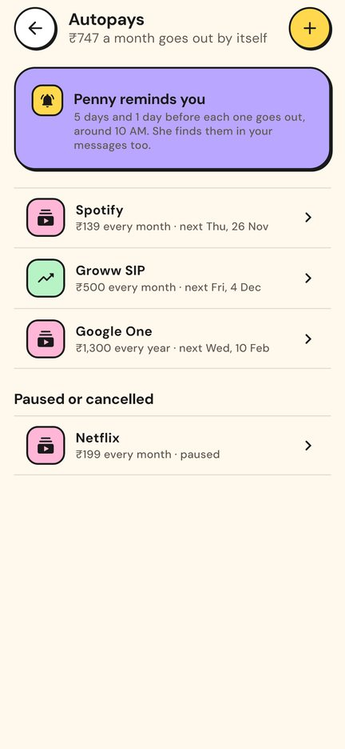<br>**Autopays**, with reminders 5 days and 1 day before | 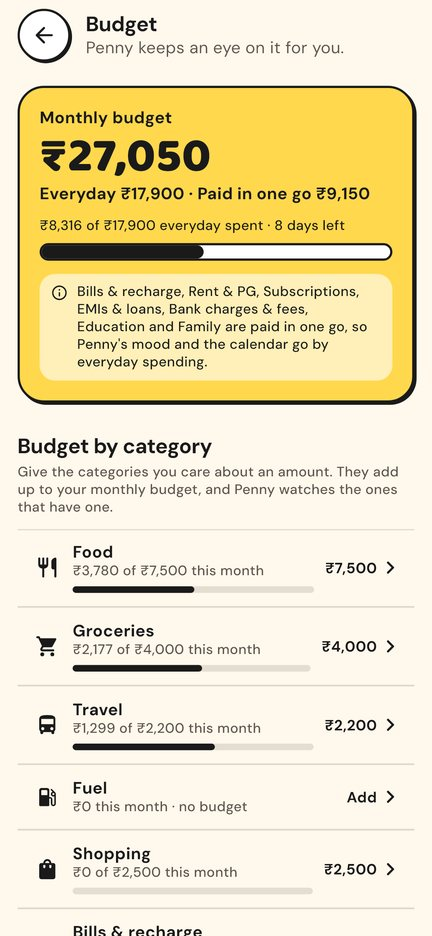<br>**Budget**: everyday and paid in one go |
| 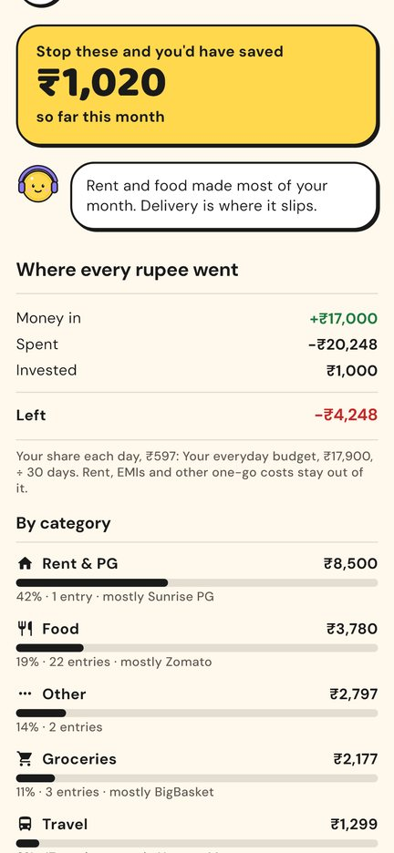<br>**The Money report** after asking Penny | 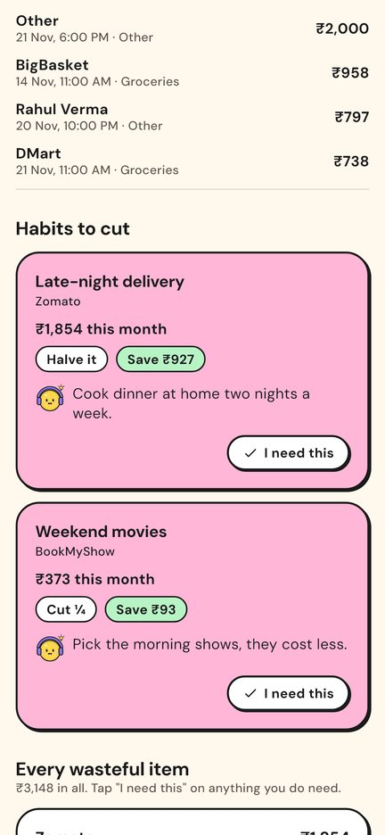<br>**Habits to cut**, and what cutting saves | 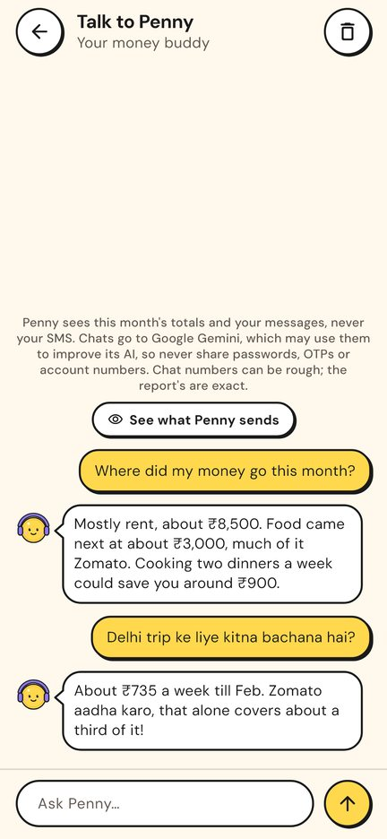<br>**Talk to Penny** in English, Hindi or Hinglish |
| 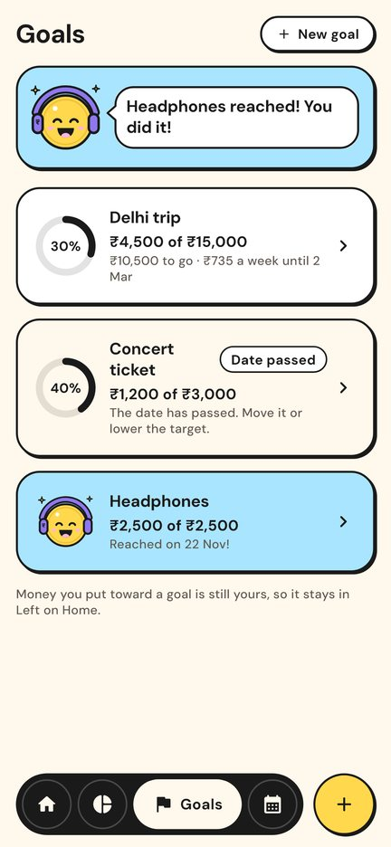<br>**Goals** with rings | <br>**Mood calendar** | 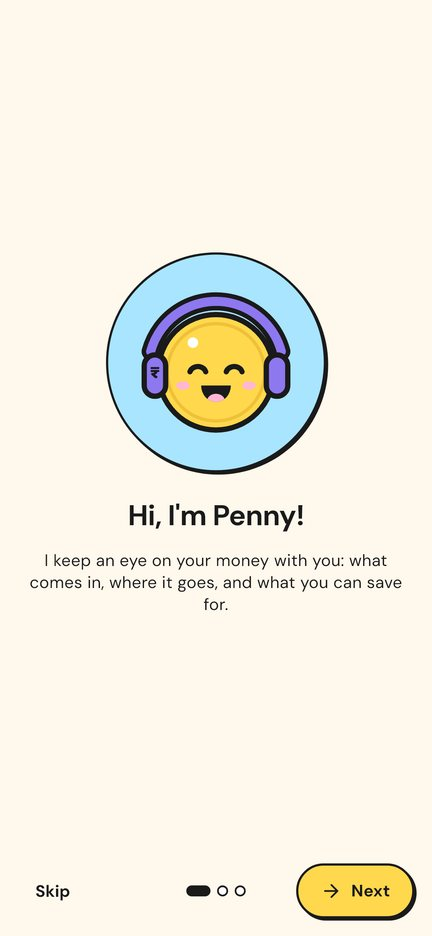<br>**The welcome** |

**Penny's notifications** carry her face for today and what's left of today's share:

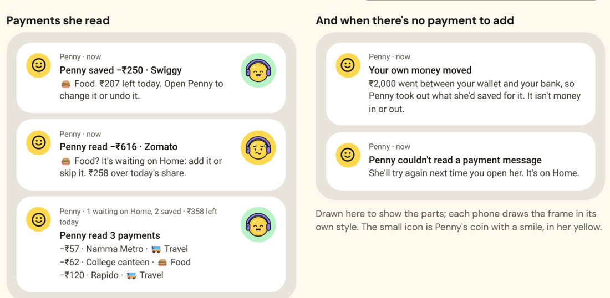

**The crafted look**: every category has a drawn icon on its colour, and who was paid shows as a monogram:

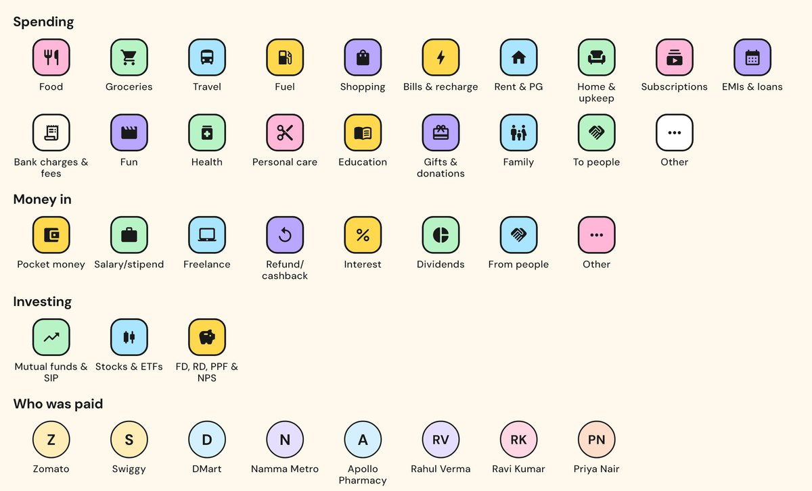

Every screen, the design system and how Penny is built are explained in [docs/Penny-Product-and-Technology.pdf](docs/Penny-Product-and-Technology.pdf).

## What works now

- **Add in under 5 seconds**: type the amount on the keypad, pick a category, tap ✓. Undo is one tap away. The keypad adds and takes away like a calculator (3000 + 2500 − 200) wherever you type an amount, and once an amount is in, its keys get smaller so the categories have the room.
- **Log faster**:
  - **Split it**: ÷2 ÷3 ÷4 above the keypad divide what you typed, to the paisa (₹1,000 ÷ 3 is ₹333.33), and "₹1,000 ÷ 3" shows until the amount changes.
  - **Again?**: up to four of the entries you log again and again (same category, place and amount, twice in the last 60 days) are a tap from filled in. ✓ still saves.
  - **Type it**: in Where, "240 Swiggy", "auto 45" or "Rs.20 Chai point" fill in the amount, place and category at once, guessed from the shops Penny knows and everyday words. This works while no amount is typed yet, so a place like "Sector 18" never changes one.
- **Combine entries**: in See all, hold an entry and tap the others, then Combine makes one entry for their total, on the latest one's day and time, with Undo. Only money of one kind combines. A combined entry says "2 in 1", and its screen lists what it was made of, each with its day, time and where it came from, with Split them apart (and Undo). When one payee has two or more payments out on one day of the last week, Home offers "Make these one?"; Not now is remembered.
- **Paybacks**: when a friend pays you back their share, log it under Got → Paid back and say what it was for. It reads "Food · paid back", comes off that category's spending (never below zero) on Home, Analysis, the budget and Penny's mood, and isn't counted as income. A day keeps what you paid that day, and its sheet says what came back.
- **Investing**: three kinds of money put away, not spent: Mutual funds & SIP, Stocks & ETFs, and FD, RD, PPF & NPS. Fund houses, Groww, Coin, Kuvera, INDmoney, NACH and BSE SIP debits, brokers like Zerodha and Upstox, and deposits are recognised, even when an SMS never says "invested". Investing stays out of Spent, the budget, the mood and necessary vs wasteful; Left takes it off with "₹1,000 invested" under it, and Analysis shows each kind under Put away.
- **Categories**: spending has Food, Groceries, Travel, Fuel, Shopping, Bills & recharge, Rent & PG, Home & upkeep, Subscriptions, EMIs & loans, Bank charges & fees, Fun, Health, Personal care, Education, Gifts & donations, Family, To people and Other; income has Pocket money, Salary/stipend, Freelance, Refund/cashback, Interest, Dividends, From people and Other.
- **Bank SMS import**: share an SMS from Messages to Penny, or paste one. It's read on the phone: numbers are masked, OTPs and look-alikes (payment requests, reminders, offers) are refused with a reason, and the SMS itself is never saved.
- **Payments read from notifications** (Android, opt-in): once you allow Penny on Android's Notification access page (Settings → Reading payments → Read payment notifications), it reads payments from your SMS app and from payment, wallet and investing apps (GPay, PhonePe, Paytm, PayZapp, MobiKwik, CRED, BHIM, super.money, Groww, Kite, Upstox, INDmoney and Paytm Money), with the same rules as a shared SMS. An SMS counts only when it's from a bank, a wallet or an investment: a sender code (with or without its prefix, like HDFCBK), a money brand's name (HDFC Bank, PayZapp), or a message showing a masked account or card number (A/c XX4821, card ending 4455); a friend's text never does, even one that says "account" or "wallet", and the Messages app's notification for it is passed over unkept. Loading a wallet or UPI Lite, sending to your own account, and a lender's receipt are left out, so nothing counts twice.
  - **Your own money moving**: money between PayZapp and your bank comes as two messages, the wallet's ("Rs.2000 deducted from PayZapp Wallet") and the bank's ("credited from VPA …@pzw"). A debit and a credit of the same amount within 15 minutes, one from each side, are one move between your own accounts: neither counts. Whichever comes second takes the first out, and the wallet is remembered, so its messages alone are let go after. An entry read from a message has "This was my own money moving", which takes out its other half too, and Home offers to take out moves saved as two entries in the last three months. Paying a shop from the wallet still counts.
  - **Wait for me to check**: each waits on Home under "payments to check" (Add with Penny's guessed category, open it to change anything, or Skip). One that looks like an entry you have says so.
  - **Save straight away**: every payment is saved at once, with Undo. One Penny can't place goes in To people or From people for a person, else Other. The same payment seen twice (the bank's SMS and a payment app's notice within half an hour, or an investment's debit and the fund's confirmation within three days, or one investment told twice by one app, like a SIP's payment and its autopay or order notice, unless they name different funds) is kept once; two payments of the same amount from one place are both saved; one like an entry you typed that day is saved, and Penny says it may repeat it.
  - **Penny's own notification** says what she read when she isn't on screen, like "Penny read −₹250 · Swiggy", and opens Home. With a budget, it also says what's left of today's share ("₹347 left today") and shows her face in today's mood; on screen, a message at the bottom says it. With Penny closed, a hidden copy of her reads them. Settings → Reading payments → **What Penny read** lists the last 20 notifications she looked at and what she did with each, never the message. Entries read this way show "Auto".
  - **Bank SMS directly** (Settings → Reading payments → Read bank SMS too, which asks Android's SMS permission): Penny receives each SMS as it arrives, even when closed, and looks at new ones whenever she opens or reads (the first time, the last two days; Read older bank SMS, on the same page, goes back the 1, 2 or 3 months picked on its slider, a batch at a time, and never adds a payment already in the entries), so a bank SMS is read even when its notification was missed or cleared. Only money messages from banks, wallets and investments are kept; every other SMS is passed over. Penny never sends SMS. An amount without ₹ or Rs ("transaction of 641.00") is read too.
  - **Money back**: a reversal or refund ("Your UPI transaction of 641.00 has been reversed") cancels the payment of the same amount from the week before: it goes in that payment's category as money back, so Spent goes back down. With no such payment, it's a refund.
  - **What the rules can't read**: a money SMS or notice that says money moved, but that Penny's rules can't read, goes to her AI with names and numbers hidden (see Privacy). When the AI can't answer, it waits on Home as one she couldn't read yet.
- **Export**: Settings → Export entries sends every entry as a CSV, through the share menu, that opens in Excel or Google Sheets.
- **Analysis**: spent, got and left, the necessary-vs-wasteful split, every category biggest first with its share as a bar, what's left of its budget and what came back, what you put away, and the last six months as a chart.
- **Autopays**: Penny keeps a list of payments that go out by themselves, like UPI autopays, mandates and SIPs, with what they come to a month.
  - **Found from messages**: a mandate set up adds one; the bank's note a day or so before ("will be debited on 23-11-2026 … for UPI Mandate") sets its next day; one paid, like GPay's "Payment for Autopay … was successful", moves it to the next one; "has been cancelled" ends it and takes it off Coming up. Or add one by hand: who it's to, how much, how often and the next day, with Pause and Delete.
  - **Reminders**: 5 days and 1 day before each one, around 10 AM, in Penny's words ("Psst! Spotify in 5 days"), on their own notification channel. Android alarms show them even with Penny closed, and they come back after a restart.
  - Home's Coming up shows the next ones beside what messages said; Settings → Autopays lists them all.
- **Month routines**:
  - **Fixed bills**: in a month's first week, Home offers last month's rent, bills, subscriptions and education not logged yet. Log adds one today, with Undo; Skip hides it for the month.
  - **Forecast**: from the 3rd, Penny's box says where the month is heading at your everyday pace: what will be left of the everyday budget, the day it runs out, or about how much the month comes to without one. Worked out on the phone.
  - **Search**: find a place, a category or an amount on Transactions, with the Spent/Got and Category filters; anything narrowed down is added up ("3 entries · spent ₹730").
- **Wasteful report** (Gemini): Penny sorts the month's spends into necessary and wasteful, picks habits worth cutting with a tip each, and the app works out what cutting them would have saved. "I need this" moves a habit back to necessary, and you can change any entry's tag yourself. The report ends with a few ideas for earning a little extra.
- **My needs**: mark each category and each shop you've paid as Need, Penny (she decides) or Wasteful, and leave Penny a short note about your life. An entry's own tag beats your shop rule, which beats your category rule, which beats Penny's pick. The split updates at once.
- **Talk to Penny** (Gemini): tap Penny on Home and ask her how to save, in English, Hindi or Hinglish. She knows this month's totals as Home shows them, your My needs, your note, your budget and your goals, and treats rent, bills, subscriptions and education as fixed costs. With no goals set she doesn't assume any; she suggests adding one.
- **Budget and Penny's moods**: give each category you care about a monthly amount. The monthly budget is their total, split into everyday spending and what's paid in one go (rent, bills, subscriptions, EMIs, bank charges, education and money sent to family). One rule gives every day Penny's mood, and Home shows today's, so Home and the calendar always agree: **that day's everyday spending** against its share of the budget (the everyday budget ÷ the days in the month). Happy at or under it, so a day with nothing spent is happy; worried up to 1.5 times it; sad above that. How the month is going never colours a day: it shows in Home's box and on the month's card.

  A day a goal is reached is celebrating. Categories without a budget aren't counted, and rent and the rest paid in one go never change her mood: Home notes when one goes over its budget, and when a category is near its own. Home's line is about today ("Nothing spent today. Nice!"), and its box leads with what's left of today's share ("₹439 left today"), then the month against the everyday budget, each with a bar, any everyday category over or near its budget, and when the everyday budget runs out at this pace. Analysis says what's left of each category's budget, and Budget shows each one used as a bar.
- **Lock Penny** (Settings, off until you turn it on): asks for your fingerprint or the phone's PIN when Penny opens, and when you come back after a minute away. Turning it on or off asks too, and needs a screen lock on the phone. Her notifications and her hidden copy keep working while she's locked.
- **Mood calendar**: every day by the same rule, Penny's face on its colour: mint happy, yellow worried, pink sad, sky blue for a goal reached. Under the month, its mood: the face most days had, a tie going to the worse face and goal days counting for neither ("14 happy · 6 worried · 1 sad · 1 goal day"), with the everyday budget spent so far and each everyday category over or near its budget. Tap a day for its entries and the numbers behind its face: what counted against the share, and what had no budget or was paid in one go.
- **Demo data**: Settings (the gear on Home) → Demo data swaps in four months of made-up money, with a budget, goals and My needs, to try every screen on. It lives in its own database, so your own entries stay untouched and come back when you turn it off. Reset starts it again from today, and sample bank SMS are there to paste.
- **Goals** (Gemini plans): save for something by a date, with what's needed each week. Note money in and out; reaching the target sets Penny celebrating. Plan with Penny picks up to four cuts from last month's spending, and the phone works out what each saves a month against what the goal needs.
- **Penny moves**: she floats and blinks, bops to her headphones when happy, sweats when worried, cries when sad, and hops in confetti when celebrating; a new mood lands with a bounce. Moments get their own faces: thinking while the chat waits, glasses on while a report or plan is worked out, an idea beside tips, sleepy where nothing's logged. She keeps still when the phone asks for less motion. All of it is drawn in code, no animation files. On Home, the goals and her chat she talks in a speech bubble pointing at her, and on a goal's page she sits inside a ring that fills as the money goes in. Each tab's cards rise in on its first look and its big amounts count up, once, and never when the phone asks for less motion.
- **The look**: crafted. Every category has a drawn, rounded icon on its colour, and an entry shows who was paid as a letter monogram on a soft colour ("Z" for Zomato, "RK" for a person), never emoji. Lists and the month's totals sit flat between hairlines; only Penny's card, the main buttons and the + keep the bold ink outline and hard shadow. Headings are in DM Sans, and Baloo 2 stays for money. Totals (Spent, Got and Left, the budget, the report's money in and out) show whole rupees; a single entry keeps its paise. Settings is a short list (Back up with Google, Lock Penny, Reading payments, Autopays, Demo data, then Export and the welcome), each opening its own page with Back to the list.
- **First launch**: three short pages (meet Penny, what stays private, where to start), shown once and again from Settings. The app icon and launch screen are Penny too, drawn from her own painter by `tool/render_icons_test.dart`.
- **Backup and sync** (optional): sign in with Google in Settings → Back up with Google, and your entries, budgets, goals with their money, autopays, My needs rules and note are kept in your account and synced: as the app opens or comes back, a few seconds after a change, and on Sync now. A new phone signs in and gets everything back; two phones end up the same, the newer edit of each row winning. An edit always counts as newer than the one it replaces, even within the same second or on a phone whose clock is behind, and when the account refuses an edit because it already has one as new, the phone takes the account's. Sign out keeps everything on the phone. Delete account removes the account and its copy, and can clear the phone too. The app works fully without an account, and backup pauses while demo data is on.
- **Offline-first**: everything lives on the phone in SQLite (Drift). Amounts are integer paise, never floating point. Rows carry UUIDv7 ids, timestamps and soft deletes, ready for sync.

## Privacy

- Reading notifications happens on the phone and only with your permission. Penny looks only at your SMS app and the payment, wallet and investing apps listed above, ignores every other app's notifications as they arrive, and keeps only what looks like a payment: the notification's text waits in Penny's private storage until Penny reads it, then is deleted, and what's waiting to be checked keeps only the read entry and its masked preview. What Penny read keeps what she did with each, never the message. None of it is synced.
- With Read bank SMS on, SMS are read on the phone in the same way: only a bank's, wallet's or investment's message with money in it is kept, until it's read; personal SMS are passed over as they come and never stored.
- The one exception: a money SMS or notice that says money moved but that Penny's rules can't read is sent to her AI (the read-sms Edge Function). Before it leaves the phone, every word that could be a name is swapped for a tag like [w3]: a capitalised word that isn't a money word or a shop or brand Penny knows, any word of a UPI ID, an email or a web address, and the words right after "to", "from", "paid" and the like, whatever their case. Account, card and long reference numbers become •••. Plain lowercase words, like "moved", go as they are, so the AI can tell what happened, and a person's name never reaches it; Penny puts the payee back on the phone from the AI's tags. OTPs, offers, friends' texts and messages with no money moving are never sent. One waiting to be read again is kept on the phone only.
- Penny calls the AI when you tap Ask Penny, Refresh or Plan with Penny, when you send her a chat message, and by herself when you open a report for a month she has looked at before whose entries, note or budget have changed since.
- She sends one month as totals per shop, plus your note and budget, and what came back per category and what you invested as totals: never single entries, SMS text, account numbers, or the names of people you pay (they go as "Person 1, 2"). A payee you type goes only as the words Penny knows from a list of everyday expenses, shops and brands, like "Cook" from "For Cook"; any other word could be a name, so it stays on the phone (tested against `test/fixtures/payee_names.json`). A plan also sends that goal, and the chat your goals, Penny's mood on Home and your messages; any run of 9 or more digits in messages, the note and goal titles is hidden as ••• on the phone before it's sent, and again on the server. "See what Penny sends" lists exactly what goes out.
- Gemini sorts, picks and explains; every rupee in the report and in a plan is computed on the phone, and the server drops any sentence from Gemini that contains a number. In the chat Penny may use numbers from your month, saying "about" for estimates.
- On Gemini's free tier, Google may use what's sent to improve its products. The chat screen says so.
- The Gemini key lives only in Supabase's secrets. Its logs hold timings and token counts, never messages. Reports and the chat are stored on the phone; Clear chat deletes it.
- Android's own backup is off for Penny, so her data never goes to Google Drive or another phone by itself; after a reinstall it comes back only through her backup.
- Until you sign in for backup, the server keeps nothing about your money, only a count of AI calls per day. With backup on, your entries (payees included), budgets, goals and their money, autopays, My needs rules and note are stored in Supabase (Mumbai) under your account. Row-level security lets only that signed-in account read or write them through the app; the project's owner can see them in the Supabase dashboard. SMS text and fingerprints, the chat, and Penny's reports and plans never leave the phone. Delete account removes the account and its copy.

## Stack

Flutter · Riverpod · go_router · Drift (SQLite) · flutter_animate · fl_chart · Supabase (anonymous and Google sign-in, Postgres with row-level security for sync, Edge Functions in Deno and TypeScript) · google_sign_in · Gemini with schema-bound JSON output.

## Architecture

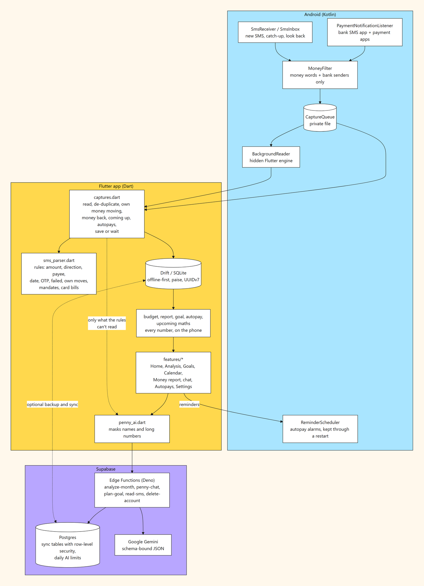

The diagram's source is [docs/architecture.mmd](docs/architecture.mmd) (Mermaid).

**How a payment flows.** A bank SMS or a payment app's notification arrives:
1. **Android filters it first.** `MoneyFilter` keeps only messages with an amount, and for SMS only those from a bank, wallet or investment sender. A friend's text is never stored.
2. **It waits** in a private file (`CaptureQueue`) until Penny reads it: right away if she's open, or else through a hidden copy of the app (`BackgroundReader`).
3. **The rules read it.** `sms_parser.dart` works out the amount, debit or credit, payee, date and category. It lets go of OTPs, requests, failed payments, payments not made yet (which go to Home's *Coming up* card and set an autopay's day), moves between your own accounts and credit card bills, and notes mandates set up, paused or cancelled in Autopays.
4. **The rules aren't the end of it.** `captures.dart` checks the reading against what's already there:
   - one payment seen twice (the bank's SMS and GPay's notice, or a SIP's two messages from one app) is kept once;
   - the two halves of your own money moving (out of the PayZapp wallet, into the bank) are paired, and neither counts;
   - a payment already typed by hand or restored from backup isn't added again;
   - a reversal or refund cancels the payment it's for;
   - a shop or person you've categorised before keeps your category.
5. **It's saved, or waits** on Home for you to check, as you choose in Settings.
6. **A message that says money moved but that the rules can't read** goes to the AI (`read-sms`). Every word that could be a name is first swapped for a tag like `[w3]`, and long numbers become `•••`. The payee is put back on the phone.

**Where things live:**
- **Phone (the source of truth):** SQLite through Drift. Amounts are integer paise, never floating point. Rows carry UUIDv7 ids, timestamps and soft deletes, so the app works fully offline and sync can merge edits.
- **Riverpod providers** connect the database to the screens. The maths (`money_kinds`, `budget_math`, `report_math`, `goal_math`, `autopay_math`, `upcoming_math`, `own_moves`) is plain Dart functions with tests.
- **Server (only for what needs one):**
  - Edge Functions call Gemini with a fixed JSON schema and clean every answer before the app sees it. Sentences with digits are dropped, so numbers only ever come from the phone.
  - Daily limits are counted per user in Postgres.
  - Backup (Google sign-in) syncs the user's own rows. Row-level security lets only that account read or write them, the newer edit wins, and deletes stay soft so they reach every phone.

**What the AI gets:** `insight_builder.dart` builds exactly what's sent:
- the month's totals per shop, with people as "Person 1, 2";
- income by category;
- the eleven months before, as totals only;
- your budget and your note.

"See what Penny sends" in the app shows it line by line.

## Run it

```bash
flutter pub get
dart run build_runner build -d
flutter run --dart-define-from-file=env/supabase.json
```

`env/supabase.json` holds your Supabase project's URL and publishable key, and the Google web client ID for backup (copy `env/supabase.example.json`). Without it the app runs fully offline and the report says the AI isn't set up; without the client ID, Settings says backup isn't set up.

Google sign-in needs, in the Google Cloud console, an OAuth consent screen, a Web application client (its ID and secret go in Supabase under Authentication → Sign In / Providers → Google) and an Android client for the package `com.naman9245.penny` with the SHA-1 of the key the app is signed with (`cd android && ./gradlew :app:signingReport`).

To install on a phone, build one APK per phone type and use the one that matches (`app-arm64-v8a-release.apk` for most phones today):

```bash
flutter build apk --release --split-per-abi --dart-define-from-file=env/supabase.json
```

To try a change on a phone that already has Penny, build a preview instead. It installs beside her as "Penny Preview", with its own data, so her money is never touched (a build signed on another computer can't replace her anyway; Android would ask to uninstall her first, which deletes what's on the phone):

```bash
flutter build apk --release --split-per-abi --dart-define-from-file=env/supabase.json -P preview=true
```

After changing how Penny looks, redraw the icon and launch images, then regenerate them:

```bash
flutter test tool/render_icons_test.dart
dart run flutter_launcher_icons
dart run flutter_native_splash:create
```

## Backend

`supabase/` holds the server side:

- `migrations/`: the `ai_usage` table and the functions behind the daily limits, counted apart for reports, chat and plans; and the sync tables (`txns`, with what an entry was combined into, `budgets`, `goals`, `goal_deposits`, `autopays`, `tag_rules`, and `prefs` for the note). Only the signed-in account can read or write its rows, never an anonymous one. Every change gets the next number from `sync_seq`, one account's changes commit in order, the newer edit wins, and deletes stay soft so they reach every phone.
- `functions/_shared/`: what the functions share: the month's schema with the budget, masking, the Gemini call and the limits.
- `functions/analyze-month/`: the report. It checks the request, counts the call, asks Gemini for JSON in a fixed schema, and cleans the answer before returning it.
- `functions/penny-chat/`: the chat. It checks the month, the goals and the last 12 messages, masks long digit runs, and returns Penny's reply as plain text.
- `functions/plan-goal/`: a goal's plan. It checks the month and the goal, asks Gemini for up to four cuts in a fixed schema, and drops any that touch a need.
- `functions/read-sms/`: reads one money message the rules couldn't, sent with names and long numbers already hidden, and answers in a fixed schema.
- `functions/delete-account/`: deletes the signed-in account; its synced rows and call counts go with it.

To use your own project: create one, apply the migrations, deploy the five functions (`supabase functions deploy analyze-month`, `penny-chat`, `plan-goal`, `read-sms` and `delete-account`), turn on anonymous sign-ins, and add the secret `GEMINI_API_KEY`. Optional secrets: `GEMINI_MODEL` (default `gemini-3.5-flash-lite`, the fastest), `CHAT_MODEL` and `PLAN_MODEL` (if different), `DAILY_USER_LIMIT` (10 reports) and `DAILY_TOTAL_LIMIT` (50), `CHAT_USER_LIMIT` (30 messages) and `CHAT_TOTAL_LIMIT` (200), `PLAN_USER_LIMIT` (10 plans) and `PLAN_TOTAL_LIMIT` (50).

## Test

```bash
flutter analyze
flutter test
cd supabase/functions && deno test
```

To look every screen over without a phone, draw them on the demo data, with Penny's own fonts, into `build/screenshots/`:

```bash
flutter test tool/screenshots_test.dart
```

## Layout

```
lib/
  core/       theme tokens and type, router, config, money and date helpers
  data/       Drift database, repositories, Riverpod providers, demo data,
              the Google account and sync
  models/     enums, categories, Penny's moods, the budget, the report and plans
  services/   SMS parser, captures, own money moving, share inbox, what Penny
              sends, report, budget, goal, autopay and plan maths, AI client
  features/   home, add_txn, import, transactions, analysis, report, needs,
              chat, budget, goals, autopays, calendar, settings, welcome, lock
  widgets/    brutal card/button/chip/pill, flat section, category icons and
              monograms, keypad, pill nav bar, split bar, meter bar, progress
              ring, speech bubble, page header, card titles and stat tiles,
              first-look motion, Penny
assets/icon/  the icon and launch images Penny's painter draws
tool/         render_icons_test.dart, which draws them, and screenshots_test.dart,
              which draws every screen
android/      Kotlin: the notification listener, SMS receiver and inbox,
              money filter, capture queue, hidden background reader,
              Penny's own notification and the autopay reminder alarms
supabase/     migrations, and the analyze-month, penny-chat, plan-goal,
              read-sms and delete-account Edge Functions
docs/         Penny-App-Overview.pdf, the app explained for anyone, and
              Penny-Product-and-Technology.pdf, every screen, the design
              system and how Penny is built; screenshots/ for this README
```

## Roadmap

1. ✅ Setup, theme, local database, manual entry, transaction list
2. ✅ Paste or share a bank SMS, parsed on the phone; analysis charts
3. ✅ Gemini through Supabase Edge Functions: wasteful-spending report, My needs, a chat with Penny
4. ✅ Budgets, goal planner, Penny's moods, mood calendar
5. ✅ Penny's animations, polish (icon, launch screen, welcome), Google sign-in with backup and sync
6. ✅ Faster logging (split, usual entries, type it), paybacks and investing, fixed bills, a forecast and search
7. ✅ Payments read from notifications (bank, wallet and investing SMS, payment, wallet and investing apps), checked first or saved straight away, Penny's own notification and What Penny read, reading with Penny closed, AI for what the rules can't read, more categories, and CSV export
8. ✅ The Money report (where every rupee went, history, every wasteful item explained, patterns), payments coming up, reading older bank SMS, payments never saved twice, the app lock, and fixes from two outside reviews

From real use (18 to 22 Nov 2026): ✅ your own money moving between wallet and bank, one SIP counted once, what a combined entry is made of, autopays and Penny's reminders, Penny's face and today's money in notifications, the crafted look (drawn icons, monograms, flat lists), and whole rupees for every total.

9. Later: receipt photos

Ideas being weighed: **My accounts and cards** (the last four digits of your own accounts and cards, so every move between them and every card bill is recognised for certain), and before sharing Penny widely, a release key of her own, a Play Store listing and a privacy policy.

## License

Penny's code is under the [MIT License](LICENSE). Baloo 2 and DM Sans are bundled under the SIL Open Font License.
